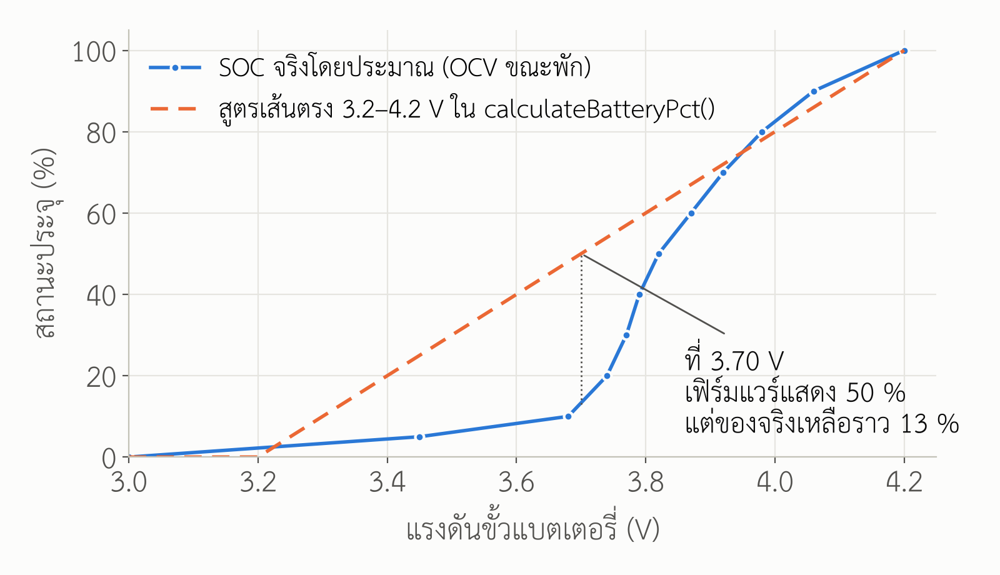

# 1. ขอบเขตและที่มาของข้อมูล

เอกสารนี้รวบรวมข้อมูลเชิงเทคนิคของแบตเตอรี่ที่พิมพ์บนฉลากว่า
**"HJ 802540 + 3.7V 600mAh"** (เซลล์ลิเธียมพอลิเมอร์แบบซองอะลูมิเนียม เซลล์เดียว
พร้อมสายสีแดง-ดำและขั้วต่อพลาสติกสีขาว ๒ ขา) ซึ่งเป็นแบตเตอรี่ขนาดที่พบมากในโดรนขนาดเล็ก
และอุปกรณ์อิเล็กทรอนิกส์พกพา

**ข้อจำกัดสำคัญ** ผู้ผลิตที่ใช้รหัส "HJ" ไม่ได้เผยแพร่เอกสารข้อมูลจำเพาะ (datasheet)
ต่อสาธารณะ ตัวเลขในเอกสารนี้จึงมาจาก ๓ แหล่งตามลำดับความน่าเชื่อถือ และระบุแหล่งไว้ทุกแถว

| สัญลักษณ์ | แหล่ง | ความหมาย |
|---|---|---|
| **[ฉ]** | ฉลากบนตัวแบตเตอรี่ | ข้อมูลที่ผู้ผลิตรับรองโดยตรง |
| **[ม]** | มาตรฐานสากล / datasheet ของเซลล์ขนาดและเคมีเดียวกัน | ค่าที่เซลล์ประเภทนี้ "ควร" เป็น |
| **[ท]** | ทฤษฎีไฟฟ้าเคมีและงานวิจัยที่ตีพิมพ์ | ค่าคำนวณ หรือค่าทั่วไปของเคมีชนิดนี้ |

datasheet ที่ใช้เทียบหลักคือ **Renata ICP622540PMT** (3.7 V 600 mAh ลิเธียมพอลิเมอร์
ขนาดใกล้เคียงกัน) [R5] เพราะเป็นผู้ผลิตที่เผยแพร่ข้อมูลครบและตรวจสอบได้
ค่าใดที่จะใช้ตัดสินใจทางวิศวกรรม **ต้องยืนยันด้วยการวัดเซลล์จริงตามภาคผนวก ก**

# 2. การถอดรหัสฉลาก

| ข้อความบนฉลาก | ความหมาย | แหล่ง |
|---|---|---|
| `HJ` | รหัสผู้ผลิต/ตราสินค้า | [ฉ] |
| `802540` | รหัสขนาดเซลล์ซองตามธรรมเนียมอุตสาหกรรม: หนา **8.0 mm** × กว้าง **25 mm** × ยาว **40 mm** (ตัวเลข ๒-๒-๒ หลัก หน่วยมิลลิเมตร หลักแรกเป็นทศนิยม 1 ตำแหน่งของความหนา) | [ม] |
| `+ 3.7V` | แรงดันกำหนด (nominal) ของเซลล์ลิเธียม-โคบอลต์ออกไซด์ (LiCoO₂) กับขั้วลบกราไฟต์ | [ฉ] [ท] |
| `600mAh` | ความจุกำหนด (rated capacity) เมื่อคายประจุที่อัตราต่ำ (ปกติ 0.2C) จาก 4.2 V ลงถึง 3.0 V | [ฉ] [ม] |
| ถังขยะมีกากบาท | สัญลักษณ์ห้ามทิ้งปนขยะทั่วไป ตามระเบียบ WEEE / ระเบียบแบตเตอรี่ของสหภาพยุโรป | [ฉ] [R12] |
| สายแดง (+) ดำ (−) ขั้วต่อขาว ๒ ขา | ขั้วต่อระยะห่างขา 2.0 mm แบบที่ใช้ในโดรนขนาดเล็ก (มักเรียก Molex 51005 / "Syma") — **ไม่ใช่** JST-PH และเสียบสลับขั้วได้ถ้าใส่ผิดด้าน ต้องตรวจขั้วด้วยมัลติมิเตอร์ก่อนต่อเข้าวงจรทุกครั้ง | [ม] |

# 3. ข้อมูลจำเพาะทางไฟฟ้า

ตาราง 1 ข้อมูลจำเพาะทางไฟฟ้า

| รายการ | ค่า | แหล่ง / หมายเหตุ |
|---|---|---|
| เคมี | ลิเธียมไอออนพอลิเมอร์ (LiCoO₂ / กราไฟต์, อิเล็กโทรไลต์เจล) | [ท] R1, R2 |
| แรงดันกำหนด | 3.7 V (บางผู้ผลิตระบุ 3.6–3.8 V) | [ฉ] |
| แรงดันชาร์จเต็ม | **4.20 V ± 0.05 V** (ห้ามเกิน 4.25 V) | [ม] R5, R6 |
| แรงดันตัดการคายประจุ | 3.0 V (ปลายทางการวัดความจุ) / ต่ำสุดที่ยอมรับ 2.75 V | [ม] R5 |
| ความจุกำหนด / ความจุต่ำสุด | 600 mAh / ≈ 550 mAh | [ฉ] / [ม] R5 |
| พลังงานกำหนด | 3.7 V × 0.600 Ah = **2.22 Wh** | [ท] คำนวณ |
| วิธีชาร์จ | กระแสคงที่-แรงดันคงที่ (CC/CV) ตัดเมื่อกระแสลดเหลือ ≈ 0.05C (30 mA) | [ม] R5, R6, R10 |
| กระแสชาร์จมาตรฐาน / สูงสุด | 0.5C = **300 mA** / 1C = 600 mA | [ม] R5 |
| กระแสคายประจุต่อเนื่อง | 1C = 600 mA สำหรับเซลล์ทั่วไป | [ม] R5 |
| กระแสคายประจุสำหรับเซลล์รุ่นโดรน | ผู้ขายมักอ้าง 15C–25C (9–15 A) แต่ฉลากเซลล์นี้ **ไม่ระบุ** จึงห้ามใช้ค่านี้ออกแบบ | [ม] ไม่มีหลักฐาน |
| ความต้านทานภายใน (AC 1 kHz) | ≈ 50–150 mΩ รวมวงจรป้องกัน (เซลล์ใหม่) | [ม] [ท] R1 |
| อัตราคายประจุเอง | ≈ 2–3 % ต่อเดือนที่ 20 °C บวกอีก ≈ 3 % ต่อเดือนจากวงจรป้องกัน | [ท] R8 |
| อุณหภูมิชาร์จ | 0 °C ถึง 45 °C | [ม] R5 |
| อุณหภูมิคายประจุ | −20 °C ถึง 60 °C | [ม] R5 |
| อุณหภูมิเก็บรักษา | −20 °C ถึง 35 °C (ระยะยาว ≤ 25 °C) | [ม] R5, R9 |

## 3.1 วงจรป้องกัน (PCM)

เซลล์ขายปลีกแบบนี้มักมีแผ่นวงจรป้องกันเล็ก ๆ ซ่อนอยู่ใต้เทปฝั่งขั้ว (ส่วนสีฟ้าด้านซ้ายในภาพ)
ประกอบด้วยไอซีป้องกันตระกูล DW01 กับมอสเฟตคู่ 8205A ค่าตัดของไอซี DW01-P [R11]

| การป้องกัน | ค่าตัด (ตามไอซี DW01-P) | ผลต่อการใช้งาน |
|---|---|---|
| ชาร์จเกิน | 4.30 V ± 0.05 V | เป็นเพียงด่านสุดท้าย ตัวชาร์จต้องหยุดที่ 4.20 V เอง |
| คายประจุเกิน | 2.40 V ± 0.10 V | ต่ำกว่าจุดที่ดีต่ออายุเซลล์มาก เฟิร์มแวร์ควรหยุดใช้งานเองตั้งแต่ ≈ 3.3 V |
| กระแสเกิน / ลัดวงจร | แรงดันตกคร่อมมอสเฟต 0.15 V ≈ 3 A | ป้องกันการลัดวงจร ไม่ได้ป้องกันการใช้งานหนักเกินพิกัดเซลล์ |

**ต้องยืนยันว่ามี PCM จริง** โดยแกะเทปดู หรือวัดว่าแรงดันที่สายกลับขึ้นมาหลังลัดวงจรชั่วขณะผ่าน
ตัวต้านทาน 1 Ω (ทำได้เฉพาะผู้มีความชำนาญ) ถ้าไม่มี PCM ต้องใช้โมดูลชาร์จที่มีวงจรป้องกันในตัวเท่านั้น

# 4. ข้อมูลจำเพาะทางกายภาพ

| รายการ | ค่า | แหล่ง |
|---|---|---|
| ขนาด (ไม่รวมสาย) | 8.0 × 25 × 40 mm (เผื่อ +0.5 mm ทุกด้าน) | [ม] รหัสขนาด |
| น้ำหนัก | ≈ 14–16 g | [ม] ประมาณจากความหนาแน่นพลังงาน |
| ความหนาแน่นพลังงานเชิงน้ำหนัก | ≈ 140–160 Wh/kg | [ท] 2.22 Wh ÷ 0.015 kg |
| ความหนาแน่นพลังงานเชิงปริมาตร | ≈ 280 Wh/L | [ท] 2.22 Wh ÷ 8 cm³ |
| เปลือก | ซองอะลูมิเนียมลามิเนต (pouch) ไม่มีวาล์วระบายแรงดัน | [ม] R1 |

ซองแบบ pouch **บวมได้** เมื่อเสื่อมหรือถูกใช้ผิดวิธี กล่องต้องเผื่อช่องว่างด้านความหนา
≈ 8–10 % (ราว 0.8 mm) และห้ามบีบอัดเซลล์ด้วยโครงหรือสกรู [R1, R7]

# 5. ทฤษฎีการทำงาน

## 5.1 ปฏิกิริยาไฟฟ้าเคมี

ขณะคายประจุ ลิเธียมไอออนเคลื่อนออกจากชั้นกราไฟต์ (ขั้วลบ) ผ่านอิเล็กโทรไลต์เจล
ไปแทรกในโครงผลึก LiCoO₂ (ขั้วบวก) ส่วนอิเล็กตรอนไหลผ่านวงจรภายนอก [R1, R2]

```
Cathode (+) :  Li(1−x)CoO₂ + x Li⁺ + x e⁻   ⇌   LiCoO₂
Anode   (−) :  LiₓC₆                         ⇌   C₆ + x Li⁺ + x e⁻
Overall     :  Li(1−x)CoO₂ + LiₓC₆           ⇌   LiCoO₂ + C₆
```

ปฏิกิริยาไปทางขวาคือการคายประจุ ไปทางซ้ายคือการชาร์จ
ความต่างศักย์ของคู่ขั้วนี้อยู่ราว 3.0–4.2 V และใช้ได้เพียง x ≈ 0.5 ของลิเธียมในขั้วบวก
การชาร์จเกิน 4.2 V ดึงลิเธียมออกเกินจุดนี้ ทำให้โครงผลึกขั้วบวกเสียรูปถาวรและอิเล็กโทรไลต์แตกตัว
ซึ่งเป็นเหตุผลทางทฤษฎีที่แรงดันชาร์จเต็มถูกตรึงไว้ที่ 4.20 V [R1, R2]

## 5.2 ความจุ พลังงาน และเวลาใช้งาน

```
Energy   E = V_nom × C = 3.7 V × 0.600 Ah = 2.22 Wh
Runtime  t = (C × η_DoD) ÷ I_avg
```

* `η_DoD` คือสัดส่วนความจุที่ใช้ได้จริงก่อนถึงแรงดันตัด (0.85 เมื่อหยุดที่ ≈ 3.5 V ตามรูปที่ 1)
* อัตรา C: 1C ของเซลล์นี้ = 600 mA ; 0.5C = 300 mA ; 0.2C = 120 mA
* ผล Peukert ของลิเธียมไอออนน้อยมาก (เลขชี้กำลัง ≈ 1.05) ที่อัตรา ≤ 1C ความจุที่ได้จึง
  ลดลงไม่เกินราว 5 % เทียบกับ 0.2C [R1]

## 5.3 ความสัมพันธ์ระหว่างแรงดันกับสถานะประจุ (SOC)

แรงดันวงจรเปิด (OCV) ของ LiCoO₂ **ไม่เป็นเส้นตรง** ช่วงกลาง 20–80 % แบนมาก
(3.74–3.98 V) และดิ่งลงเร็วใต้ 3.7 V [R1, R4] ตาราง 2 เป็นค่าประมาณทั่วไปของเคมีนี้
ขณะพักอย่างน้อย 1 ชั่วโมงที่ 25 °C **ไม่ใช่ค่าวัดจากเซลล์ HJ ตัวนี้**

ตาราง 2 แรงดันวงจรเปิดกับสถานะประจุ (ค่าประมาณ)

| SOC (%) | 100 | 90 | 80 | 70 | 60 | 50 | 40 | 30 | 20 | 10 | 5 | 0 |
|---|---|---|---|---|---|---|---|---|---|---|---|---|
| OCV (V) | 4.20 | 4.06 | 3.98 | 3.92 | 3.87 | 3.82 | 3.79 | 3.77 | 3.74 | 3.68 | 3.45 | 3.00 |



ขณะมีโหลด แรงดันที่ขั้วจะต่ำกว่า OCV เท่ากับ `I × R_int` เช่นที่ 130 mA กับ 120 mΩ
แรงดันตก ≈ 16 mV ซึ่งเล็กมากสำหรับโหลดของโครงการนี้

# 6. อายุการใช้งานเชิงเทคนิค

อายุของเซลล์ลิเธียมไอออนแบ่งเป็น ๒ ส่วนที่ **เกิดพร้อมกันและรวมกัน** [R3, R4, R7]

1. **อายุตามรอบ (cycle life)** เสื่อมจากการชาร์จ-คายประจุ
2. **อายุตามปฏิทิน (calendar life)** เสื่อมตามเวลาแม้ไม่ได้ใช้ ขึ้นกับอุณหภูมิและ SOC ที่เก็บ

เกณฑ์สิ้นอายุที่ใช้ทั่วไปคือ **ความจุเหลือ 80 % ของความจุกำหนด** (480 mAh สำหรับเซลล์นี้)
หรือความต้านทานภายในเพิ่มเป็น ๒ เท่า [R5, R7]

## 6.1 กลไกการเสื่อมตามทฤษฎี

| กลไก | สิ่งที่เกิด | ตัวเร่ง | แหล่ง |
|---|---|---|---|
| ชั้น SEI หนาขึ้น | อิเล็กโทรไลต์ทำปฏิกิริยาที่ผิวกราไฟต์ กินลิเธียมที่ใช้งานได้ ความจุหายตาม √t | อุณหภูมิสูง, SOC สูง | R3, R4 |
| ลิเธียมเคลือบผิว (Li plating) | ลิเธียมโลหะตกที่ขั้วลบแทนการแทรกเข้าชั้นกราไฟต์ เสี่ยงลัดวงจรภายใน | ชาร์จที่ < 10 °C, ชาร์จเร็ว | R3, R14 |
| ขั้วบวกเสื่อม | โครงผลึก LiCoO₂ เปลี่ยนเฟส โคบอลต์ละลาย | แรงดัน > 4.2 V, อุณหภูมิสูง | R3, R4 |
| อิเล็กโทรไลต์แตกตัวเป็นแก๊ส | ซอง pouch บวม | ชาร์จเกิน, คายประจุเกิน, > 60 °C | R1, R7 |
| คอปเปอร์ละลาย | คายประจุจนต่ำกว่า ≈ 2.0 V ทองแดงตัวรับกระแสขั้วลบละลาย ชาร์จกลับแล้วเป็นจุดลัดวงจร | คายประจุเกินแล้วทิ้งไว้ | R1, R7 |

อัตราปฏิกิริยาเสื่อมเป็นไปตามสมการอาร์เรเนียส `k = A·exp(−Eₐ/RT)`
ในทางปฏิบัติ **อุณหภูมิสูงขึ้นทุก 10 °C อัตราเสื่อมตามปฏิทินเพิ่มราว ๒ เท่า** [R3, R4, R14]

## 6.2 อายุตามรอบ

ตาราง 3 จำนวนรอบโดยประมาณจนความจุเหลือ 80 %

| เงื่อนไขการใช้งาน | จำนวนรอบ | แหล่ง |
|---|---|---|
| ชาร์จ 0.5C / คายประจุ 0.5C เต็มช่วง 4.2–3.0 V ที่ 25 °C (datasheet เซลล์เทียบ) | **≥ 500 รอบ** | [ม] R5 |
| เซลล์ทั่วไปไม่ทราบที่มา เงื่อนไขเดียวกัน | 300–500 รอบ | [ท] R7 |
| ใช้งานในโดรน (คายประจุ 5–10C, ร้อน) | 100–200 รอบ | [ท] R7 |
| ใช้งานเบาแบบโครงการนี้ (≈ 0.2C) ชาร์จ 0.5C | 400–500 รอบ | [ท] อนุมานจาก R5, R7 |

มาตรฐาน IEC 61960-3 กำหนดวิธีทดสอบอายุตามรอบที่อัตรา 0.2 It และ 0.5 It
และเกณฑ์ความจุคงเหลือไม่ต่ำกว่า 60 % ของความจุกำหนดหลังจำนวนรอบที่มาตรฐานกำหนด [R13]
เกณฑ์ 80 % ที่ใช้ในเอกสารนี้จึงเข้มกว่ามาตรฐาน

### ผลของความลึกการคายประจุ (DoD)

ตาราง 4 ผลของ DoD ต่ออายุรอบ (เคมี NMC/LCO จนเหลือ 70 %) จาก Battery University [R7]

| DoD | 100 % | 80 % | 60 % | 40 % | 20 % | 10 % |
|---|---|---|---|---|---|---|
| จำนวนรอบ | ≈ 300 | ≈ 400 | ≈ 600 | ≈ 1,000 | ≈ 2,000 | ≈ 6,000 |

พลังงานรวมที่ได้ตลอดอายุ (`รอบ × DoD`) เพิ่มขึ้นเมื่อ DoD ลดลง เช่น 100 % × 300 = 300
เทียบกับ 40 % × 1,000 = 400 รอบเต็มเทียบเท่า

### ผลของแรงดันชาร์จเต็ม

ตาราง 5 แรงดันชาร์จเต็มกับจำนวนรอบ [R7]

| แรงดันชาร์จเต็ม (V) | 4.30 | 4.25 | **4.20** | 4.15 | 4.10 | 4.05 | 4.00 |
|---|---|---|---|---|---|---|---|
| จำนวนรอบ | 150–250 | 200–350 | **300–500** | 400–700 | 600–1,000 | 850–1,500 | 1,200–2,000 |
| ความจุที่ได้ต่อรอบ (≈) | 110–115 % | 105–110 % | **100 %** | ≈ 95 % | ≈ 85 % | ≈ 80 % | ≈ 70 % |

## 6.3 อายุตามปฏิทิน

ตาราง 6 ความจุที่กู้คืนได้หลังเก็บไว้ ๑ ปี [R7]

| อุณหภูมิเก็บ | เก็บที่ประจุ 40 % | เก็บที่ประจุ 100 % |
|---|---|---|
| 0 °C | 98 % | 94 % |
| 25 °C | 96 % | 80 % |
| 40 °C | 85 % | 65 % |
| 60 °C | 75 % | 60 % (หลัง ๓ เดือน) |

ข้อสรุป: **เซลล์ที่ถูกเสียบชาร์จค้างไว้ที่ 4.2 V ตลอดเวลาในห้องอุณหภูมิ 25 °C
จะเหลือความจุราว 80 % ภายใน ๑ ปีโดยไม่ต้องใช้งานเลย** และเร็วขึ้นมากถ้าเครื่องร้อน
อายุตามปฏิทินที่สมเหตุสมผลของเซลล์ประเภทนี้คือ **๒–๓ ปี** นับจากวันผลิต [R4, R7]

## 6.4 สรุปอายุการใช้งานที่คาดได้

| รูปแบบการใช้ | ตัวจำกัดอายุ | อายุคาดการณ์ถึง 80 % |
|---|---|---|
| ใช้แบตเป็นแหล่งไฟหลัก ชาร์จวันละ ๒–๓ ครั้ง | รอบ | 400–500 รอบ ≈ **๕–๘ เดือน** |
| ใช้แบตเป็นไฟสำรอง เสียบ USB ตลอด (ค้าง 4.2 V) 25 °C | ปฏิทิน | ≈ **๑ ปี** |
| ไฟสำรอง แต่ตั้งแรงดันชาร์จ 4.10 V และระบายความร้อนดี | ปฏิทิน | ≈ **๒–๓ ปี** |
| เก็บในคลัง 40–60 % ที่ ≤ 25 °C | ปฏิทิน | ≈ ๒–๓ ปี (ต้องเติมประจุทุก ๓–๖ เดือน) |

# 7. ความปลอดภัยและมาตรฐาน

| มาตรฐาน | เนื้อหา | ความเกี่ยวข้อง |
|---|---|---|
| IEC 62133-2:2017 | ความปลอดภัยของเซลล์และแบตเตอรี่ลิเธียมพกพา | เซลล์ที่ใช้ในอุปกรณ์ต้องผ่าน [R12] |
| IEC 61960-3:2017 | วิธีวัดสมรรถนะ (ความจุ อายุรอบ ความต้านทานภายใน) | ใช้เป็นวิธีทดสอบในภาคผนวก ก [R13] |
| UN 38.3 | การทดสอบเพื่อการขนส่ง (สั่นสะเทือน กระแทก ความดันต่ำ ลัดวงจร ฯลฯ) | จำเป็นถ้าส่งเครื่องทางอากาศ [R12] |
| IEC 60601-1 (ข้อ 15.4.3) | ข้อกำหนดแบตเตอรี่ในเครื่องมือแพทย์ไฟฟ้า อ้างถึง IEC 62133 | ระบบนี้ใช้ในหอผู้ป่วย [R12] |
| Regulation (EU) 2023/1542 | การติดฉลากและการกำจัดซากแบตเตอรี่ | ที่มาของสัญลักษณ์ถังขยะบนฉลาก [R12] |

เซลล์ "HJ 802540" ที่ซื้อจากร้านค้าออนไลน์ **ไม่มีหลักฐานว่าผ่านมาตรฐานใด** การนำไปใช้กับ
ผู้ป่วยจริงจึงต้องเปลี่ยนเป็นเซลล์จากผู้ผลิตที่มีรายงานผล IEC 62133-2 และ UN 38.3

ข้อปฏิบัติด้านความปลอดภัย [R1, R6, R9]

* ห้ามชาร์จที่อุณหภูมิต่ำกว่า 0 °C หรือสูงกว่า 45 °C
* ห้ามใช้เซลล์ที่บวม มีรอยบุบ รอยเจาะ หรือมีกลิ่นหวานของอิเล็กโทรไลต์ ให้แยกเก็บในภาชนะไม่ติดไฟทันที
* ห้ามปล่อยให้แรงดันต่ำกว่า 2.5 V ถ้าเกิดขึ้นแล้วและค้างนานเกินหนึ่งสัปดาห์ ให้ทิ้ง ห้ามชาร์จกลับ
* ห้ามบัดกรีที่ตัวเซลล์โดยตรง บัดกรีที่สายหรือแผ่นวงจรป้องกันเท่านั้น
* การกำจัด ส่งเป็นขยะอันตรายตามระบบของโรงพยาบาล หุ้มขั้วด้วยเทปก่อนทิ้ง

# ภาคผนวก ก วิธีทดสอบยืนยันเซลล์จริง (อ้างอิง IEC 61960-3)

| การทดสอบ | วิธี | ผ่านเมื่อ |
|---|---|---|
| ความจุ | ชาร์จ CC 0.2C (120 mA) ถึง 4.20 V แล้ว CV จนกระแส < 0.05C พัก 1 ชม. คายประจุ 0.2C ถึง 3.0 V ที่ 20 ± 5 °C | ≥ 550 mAh |
| ความต้านทานภายใน | เครื่องวัด AC 1 kHz หรือวิธี DC: ΔV ÷ ΔI ระหว่างโหลด 0.2C กับ 1C | ≤ 150 mΩ |
| คายประจุเอง | ชาร์จเต็ม เก็บ 28 วันที่ 20 °C แล้ววัดความจุ | ≥ 90 % ของครั้งแรก |
| วงจรป้องกัน | ใช้แหล่งจ่ายปรับได้ จำกัดกระแส 50 mA ค่อย ๆ ลดแรงดันจาก 3.0 V | สายตัดที่ 2.4 ± 0.1 V |

อุปกรณ์ที่ใช้ได้ราคาไม่สูง เช่น เครื่องทดสอบความจุแบตเตอรี่แบบ USB หรือโหลดอิเล็กทรอนิกส์
ร่วมกับโมดูลชาร์จ TP4056 ที่ตั้งกระแสไว้ 0.2C

# เอกสารอ้างอิง

* **[R1]** Reddy, T. B. (ed.). *Linden's Handbook of Batteries*, 4th ed. McGraw-Hill, 2011.
  บทที่ 26 "Lithium-Ion Batteries" (เคมี LiCoO₂ กราไฟต์ เส้นโค้งคายประจุ ความปลอดภัย)
* **[R2]** Goodenough, J. B., & Park, K.-S. "The Li-Ion Rechargeable Battery: A Perspective."
  *Journal of the American Chemical Society*, 135(4), 1167–1176, 2013. doi:10.1021/ja3091438
* **[R3]** Vetter, J., Novák, P., Wagner, M. R., et al. "Ageing mechanisms in lithium-ion batteries."
  *Journal of Power Sources*, 147(1–2), 269–281, 2005. doi:10.1016/j.jpowsour.2005.01.006
* **[R4]** Broussely, M., Biensan, P., Bonhomme, F., et al. "Main aging mechanisms in Li ion batteries."
  *Journal of Power Sources*, 146(1–2), 90–96, 2005. doi:10.1016/j.jpowsour.2005.03.172
* **[R5]** Renata SA. *ICP622540PMT — Lithium Polymer Battery 3.7 V 600 mAh, Product Datasheet*.
  <https://www.mouser.com/datasheet/2/346/ICP622540PMT-519541.pdf>
* **[R6]** NanJing Top Power ASIC Corp. *TP4056 — 1A Standalone Linear Li-Ion Battery Charger* (datasheet).
  <https://dlnmh9ip6v2uc.cloudfront.net/datasheets/Prototyping/TP4056.pdf>
* **[R7]** Battery University (Cadex Electronics). *BU-808: How to Prolong Lithium-based Batteries*.
  <https://batteryuniversity.com/article/bu-808-how-to-prolong-lithium-based-batteries>
* **[R8]** Battery University. *BU-802b: What does Elevated Self-discharge Do?*
  <https://batteryuniversity.com/article/bu-802b-what-does-elevated-self-discharge-do>
* **[R9]** Battery University. *BU-702: How to Store Batteries*.
  <https://batteryuniversity.com/article/bu-702-how-to-store-batteries>
* **[R10]** Battery University. *BU-409: Charging Lithium-ion*.
  <https://batteryuniversity.com/article/bu-409-charging-lithium-ion>
* **[R11]** Fortune Semiconductor. *DW01-P — One Cell Lithium-ion/Polymer Battery Protection IC* (datasheet).
* **[R12]** IEC 62133-2:2017; UN *Manual of Tests and Criteria*, Part III, sub-section 38.3;
  IEC 60601-1:2005+AMD1:2012+AMD2:2020; Regulation (EU) 2023/1542 concerning batteries and waste batteries.
* **[R13]** IEC 61960-3:2017. *Secondary lithium cells and batteries for portable applications —
  Part 3: Prismatic and cylindrical lithium secondary cells and batteries made from them*, ข้อ 7.6.
* **[R14]** Waldmann, T., Wilka, M., Kasper, M., Fleischhammer, M., & Wohlfahrt-Mehrens, M.
  "Temperature dependent ageing mechanisms in Lithium-ion batteries – A Post-Mortem study."
  *Journal of Power Sources*, 262, 129–135, 2014. doi:10.1016/j.jpowsour.2014.03.112
