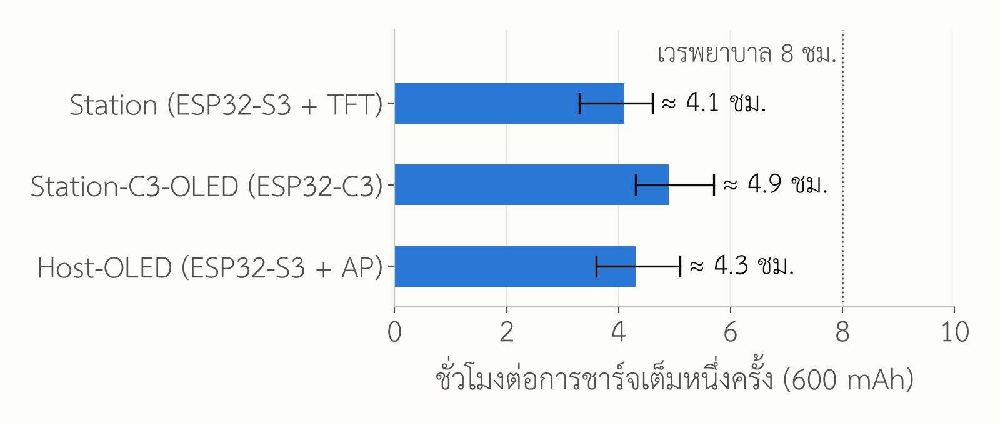

# บทสรุป

1. แบตเตอรี่ 802540 600 mAh เก็บพลังงานได้ **2.22 Wh** เมื่อใช้เป็นแหล่งไฟหลัก
   เครื่องประจำเตียงรุ่นจอ TFT ทำงานได้ **ราว ๔ ชั่วโมง** ต่อการชาร์จหนึ่งครั้ง
   (ช่วง 3.3–4.6 ชม.) ซึ่ง **สั้นกว่าเวรพยาบาล ๘ ชั่วโมง** และสั้นกว่าการให้สารน้ำส่วนใหญ่
   จึงเหมาะเป็น **ไฟสำรองเมื่อสาย USB หลุดหรือย้ายเตียง** มากกว่าเป็นแหล่งไฟหลัก
2. ถ้าใช้เป็นแหล่งไฟหลัก ชาร์จวันละ ๒–๓ รอบ เซลล์จะถึงเกณฑ์สิ้นอายุ (ความจุเหลือ 80 %)
   ใน **ราว ๕–๘ เดือน** ถ้าใช้เป็นไฟสำรองที่เสียบชาร์จค้างไว้ อายุจะถูกจำกัดด้วยเวลา
   ราว **๑ ปี** ที่ 4.20 V หรือ **๒–๓ ปี** ถ้าลดแรงดันชาร์จเต็มเหลือ 4.10 V
3. พบประเด็นในเฟิร์มแวร์และวงจรที่ควรแก้ก่อนใช้กับผู้ป่วยจริง ๖ ข้อ (หัวข้อ 6)
   ข้อสำคัญที่สุดคือ **สูตรเปอร์เซ็นต์แบตเตอรี่แบบเส้นตรงแสดงค่าสูงเกินจริงมาก**
   ที่ 3.70 V หน้าจอ Host แสดง 50 % ทั้งที่ประจุจริงเหลือราว 13 %
   และ **โมดูลชาร์จ TP4056 สำเร็จรูปตั้งกระแสไว้ 1 A ซึ่งเกินพิกัดเซลล์ 600 mAh**

ข้อมูลจำเพาะของเซลล์ ทฤษฎี และแหล่งอ้างอิงทั้งหมดอยู่ในเอกสารคู่กัน
**"ข้อมูลเชิงเทคนิคและอายุการใช้งานของแบตเตอรี่ลิเธียมพอลิเมอร์ 802540"**
(`docs/battery/ข้อมูลเทคนิคแบตเตอรี่_LiPo_802540.md`) รายงานนี้อ้างเลข [R…] ชุดเดียวกัน
และเพิ่ม [R15]–[R18] ท้ายเอกสาร

> **ข้อจำกัด** ตัวเลขทั้งหมดในรายงานนี้มาจากการคำนวณจาก datasheet และการอ่านโค้ด
> **ยังไม่ได้วัดบนฮาร์ดแวร์จริง** เช่นเดียวกับส่วนอื่นของโครงการ วิธีวัดยืนยันอยู่ในหัวข้อ 8

# 1. ระบบไฟของแต่ละเครื่องในโครงการ (สถานะปัจจุบันจากโค้ด)

| เครื่อง | บอร์ด | วัดแรงดันแบต | สูตรเปอร์เซ็นต์ | โหมดประหยัดไฟ |
|---|---|---|---|---|
| Station / Station-Stable / Station-Fallout | ESP32-S3 Super Mini + TFT 1.47" | **ปิด** `STATION_BAT_ADC_PIN = -1` (`firmware/Station/Station.ino:241`) ส่งค่า 0 จอแสดง `POWER USB` | ไม่มี | ไม่มี วิทยุเปิดตลอด `WiFi.setSleep(false)` |
| Station-C3-OLED | ESP32-C3 Super Mini + OLED 0.42" | GPIO 0 ตัวแบ่ง 1:1 เฉลี่ย 8 ค่า (`Station-C3-OLED.ino:453`) | เส้นตรง 3.30–4.20 V (`Station-C3-OLED.ino:459`) | ไม่มี |
| Host-OLED / Host-TFT28 / Host-Touch24 | ESP32-S3 | GPIO 1 ตัวแบ่ง 1:1 อ่านค่าเดียว (`Host-OLED.ino:926`) | เส้นตรง 3.20–4.20 V (`Host-OLED.ino:934`) | deep sleep เมื่อกดปิด ปลุกด้วย `ext0` (`Host-OLED.ino:969`) |

ผังวงจรใน `hardware/` **ยังไม่มีวงจรชาร์จ** และไม่ได้ระบุว่าแบตเตอรี่ต่อเข้าขาใดของบอร์ด
รายงานนี้จึงสมมติโครงที่ใช้กันทั่วไปกับบอร์ด Super Mini ดังนี้

```
USB 5V --> [TP4056 + DW01] --B+/B---> LiPo 802540
                 |                        |
                OUT+                 100k:100k --> ADC
                 |
             [switch] --> 5V pin --> LDO 3.3 V --> ESP32
```

กล่าวคือ ไฟ USB เข้าโมดูลชาร์จ TP4056 ที่มีวงจรป้องกัน DW01 ขา B+/B− ต่อเซลล์
ขา OUT+ ผ่านสวิตช์ไปยังขา 5V ของบอร์ด แล้วผ่าน LDO บนบอร์ดลงเป็น 3.3 V
ส่วนแรงดันเซลล์ถูกแบ่งครึ่งด้วยตัวต้านทาน 100 kΩ สองตัวก่อนเข้าขา ADC

# 2. การทำงานช่วงชาร์จ

ตัวชาร์จ TP4056 ทำงานแบบเชิงเส้น CC/CV ตาม datasheet [R6] แบ่งเป็น ๔ ช่วง

| ช่วง | เงื่อนไข | กระแส / แรงดัน | เกิดอะไรในเซลล์ |
|---|---|---|---|
| ๑. ชาร์จฟื้นฟู (trickle) | V_bat < 2.9 V | 10 % ของกระแสตั้ง | ค่อย ๆ ยกแรงดันเซลล์ที่คายประจุลึก ป้องกันความร้อนและลิเธียมเคลือบผิว |
| ๒. กระแสคงที่ (CC) | 2.9 V ≤ V_bat < 4.2 V | กระแสตั้ง I_CHG | ลิเธียมไอออนกลับเข้าชั้นกราไฟต์ ได้ประจุ ≈ 70–80 % ในช่วงนี้ |
| ๓. แรงดันคงที่ (CV) | V_bat = 4.20 V ± 1 % | กระแสลดลงเรื่อย ๆ | เติมส่วนที่เหลือ ≈ 20–30 % ใช้เวลาพอ ๆ กับช่วง CC |
| ๔. ตัดการชาร์จ | กระแส < I_CHG ÷ 10 | 0 | ชาร์จซ้ำอัตโนมัติเมื่อแรงดันตกต่ำกว่า ≈ 4.05 V |

## 2.1 การตั้งกระแสชาร์จ

TP4056 ตั้งกระแสด้วยตัวต้านทาน R_PROG ตามสูตร `I_CHG = 1200 ÷ R_PROG` (mA, kΩ) [R6]

| R_PROG | กระแสชาร์จ | อัตรา C ของเซลล์ 600 mAh | ใช้ได้หรือไม่ |
|---|---|---|---|
| 1.2 kΩ (ค่าที่โมดูลสำเร็จรูปใส่มา) | 1,000 mA | 1.67C | **ไม่ได้** เกินพิกัดสูงสุด 1C [R5] |
| 2 kΩ | 600 mA | 1.0C | ได้ แต่อายุสั้นลงและเซลล์อุ่น |
| 3 kΩ | 400 mA | 0.67C | ได้ |
| **4 kΩ** (ค่าแนะนำ) | **300 mA** | **0.5C** | **ตรงค่ามาตรฐานใน datasheet** [R5] |

ที่ 300 mA ตัดการชาร์จที่ 30 mA (0.05C) เวลาชาร์จจากหมดถึงเต็ม **ราว 2.5–3 ชั่วโมง**
(CC ≈ 1.5 ชม. + CV ≈ 1–1.5 ชม.) [R10]

## 2.2 ปัญหาเมื่อชาร์จพร้อมจ่ายโหลด

ถ้าต่อเครื่องไว้ที่ OUT+ ของ TP4056 ขณะเสียบ USB ตัวชาร์จจะมองเห็นกระแสโหลด
(≈ 110–140 mA) รวมกับกระแสเข้าเซลล์ กระแสจึง **ไม่เคยลดถึง 30 mA** ตัวชาร์จไม่ตัด
เซลล์ถูกค้างไว้ที่ 4.20 V ตลอดเวลา ซึ่งตามตาราง 6 ของเอกสารเทคนิค
เป็นสภาวะที่เร่งการเสื่อมตามปฏิทินมากที่สุด [R7] ทางแก้คือวงจรแบ่งเส้นทางไฟ
(load sharing) ด้วย P-MOSFET กับไดโอดชอตต์กี ให้โหลดกินไฟจาก USB โดยตรงขณะเสียบสาย
หรือใช้ไอซีชาร์จที่มี power path ในตัว (หัวข้อ 7)

# 3. การทำงานช่วงคายประจุ

## 3.1 เส้นโค้งแรงดัน


แรงดันเริ่มที่ 4.20 V ลดเร็วถึง ≈ 4.0 V ในช่วง 20 % แรก จากนั้น **แบนยาว** ระหว่าง
3.95–3.74 V ครอบคลุม 60 % ของความจุ แล้ว **ดิ่งลงเร็ว** ใต้ 3.7 V ประจุที่เหลือใต้ 3.68 V
มีเพียง ≈ 10 % [R1] จึงอาศัยแรงดันบอกเวลาที่เหลือได้แม่นเฉพาะช่วงต้นและช่วงท้าย

## 3.2 ตัวควบคุมแรงดัน (LDO) กำหนดจุดตัดที่ใช้งานได้จริง

ESP32-S3 และ ESP32-C3 ต้องการไฟเลี้ยง 3.0–3.6 V [R15, R16] บอร์ด Super Mini ส่วนใหญ่
ใช้ LDO รุ่น ME6211 (แรงดันตกคร่อม ≈ 0.1 V ที่ 100 mA และราว 0.3–0.35 V
ที่กระแสยอดขณะส่ง Wi-Fi ≈ 350 mA) [R17] ต้องตรวจรหัสบนบอร์ดจริง

```
V_cell,min  ≈  V_DD,min + V_dropout(peak)  ≈  3.0 + 0.35  ≈  3.35–3.5 V
```

ใต้ 3.4 V ไฟเลี้ยงชิปจะตกต่ำกว่า 3.0 V ทุกครั้งที่วิทยุส่งข้อมูล เสี่ยงรีเซ็ตจากวงจรตรวจไฟตก
(brownout) ความจุที่ใช้ได้จริงจึงหยุดราว 3.5 V คิดเป็น **≈ 85 %** ของความจุกำหนด

**ถ้าบอร์ดใช้ AMS1117** (แรงดันตกคร่อม ≈ 1.1 V) เซลล์ 3.7 V จะจ่ายได้เพียง ≈ 2.6–3.1 V
**ใช้กับเซลล์เดียวไม่ได้เลย** ต้องเปลี่ยนเป็น LDO แรงดันตกต่ำหรือวงจร buck-boost

# 4. งบพลังงานและเวลาใช้งาน

ตาราง 1 กระแสเฉลี่ยโดยประมาณ (ฝั่งแบตเตอรี่ ผ่าน LDO เชิงเส้น กระแสเข้าเท่ากระแสออก)

| ภาระ | Station (S3 + TFT) | Station-C3-OLED | Host-OLED | ที่มา |
|---|---|---|---|---|
| ชิป + วิทยุรับต่อเนื่อง (ESP-NOW, ไม่ sleep) | 90 mA | 80 mA | 90 mA | R15, R16 |
| วิทยุส่ง (ยอด ≈ 300 mA นาน ≈ 1 ms ต่อวินาที) | < 1 mA | < 1 mA | 5–15 mA (AP + เว็บ) | R15 |
| จอ (ไฟหลัง TFT / OLED) | 15–20 mA | 5–8 mA | 8–15 mA | ประมาณ |
| เซนเซอร์ TCRT5000 (LED อินฟราเรด + LM393) | 12–16 mA | 12–16 mA | — | ประมาณ |
| ไฟ RGB / บัซเซอร์ (เฉลี่ย) | 1–5 mA | 1–3 mA | 1–5 mA | ประมาณ |
| ตัวแบ่งแรงดัน 100k:100k + LDO ขณะเปล่า | < 0.1 mA | < 0.1 mA | < 0.1 mA | R17 |
| **รวม (ช่วงต่ำ–กลาง–สูง)** | **110 – 125 – 140 mA** | **90 – 105 – 110 mA** | **100 – 120 – 130 mA** | |

เวลาใช้งาน `t = C × 0.85 ÷ I_avg` โดยค่าต่ำใช้ความจุต่ำสุด 550 mAh กับกระแสสูงสุด
และค่าสูงใช้ 600 mAh กับกระแสต่ำสุด

ตาราง 2 เวลาใช้งานต่อการชาร์จหนึ่งครั้ง (เซลล์ใหม่ 25 °C)

| เครื่อง | ต่ำสุด | ค่ากลาง | สูงสุด |
|---|---|---|---|
| Station (ESP32-S3 + TFT) | 3.3 ชม. | **4.1 ชม.** | 4.6 ชม. |
| Station-C3-OLED | 4.3 ชม. | **4.9 ชม.** | 5.7 ชม. |
| Host-OLED | 3.6 ชม. | **4.3 ชม.** | 5.1 ชม. |



เมื่อเซลล์เสื่อมถึง 80 % เวลาเหล่านี้ลดลงตามสัดส่วนเหลือราว 3.3 / 3.9 / 3.4 ชั่วโมง

## 4.1 กระแสขณะปิดเครื่อง (Host deep sleep)

ชิป ESP32-S3 ใน deep sleep ใช้เพียง ≈ 7–8 µA [R15] แต่ทั้งบอร์ดยังมี LDO ขณะเปล่า
(≈ 40 µA) [R17] ตัวแบ่งแรงดัน (21 µA ที่ 4.2 V) และ **ไฟ LED แสดงไฟเลี้ยงบนบอร์ด**
(≈ 1–3 mA ถ้าบอร์ดมี) ถ้ามี LED เซลล์ 600 mAh จะหมดใน **๘–๒๕ วัน** แม้ "ปิดเครื่อง" แล้ว
และถ้าทิ้งไว้ต่อจนวงจรป้องกันตัดที่ 2.4 V เซลล์จะเสียหายถาวรตามกลไกคอปเปอร์ละลาย [R1]
การปิดเครื่องด้วยปุ่มซอฟต์แวร์จึง **ไม่เทียบเท่าการตัดแบตเตอรี่** ต้องมีสวิตช์ตัดวงจรจริง

# 5. อายุการใช้งานในบริบทโครงการ

ตาราง 3 สถานการณ์การใช้งานกับอายุที่คาดได้ (อ้างอิงตาราง 3–6 ของเอกสารเทคนิค [R5, R7])

| สถานการณ์ | รอบต่อวัน | อายุถึง 80 % | หมายเหตุ |
|---|---|---|---|
| ก. แบตเป็นไฟหลัก ชาร์จทุกครั้งที่หมด (DoD ≈ 85 %) | 2–3 | 400–500 รอบ ≈ **๕–๘ เดือน** | ต้องเปลี่ยนแบตปีละ ๒ ครั้ง |
| ข. ไฟสำรอง เสียบ USB ตลอด ไม่มี load sharing | ≈ 0 | ≈ **๑ ปี** (ค้าง 4.2 V) | สภาพปัจจุบันถ้าต่อตามผังในหัวข้อ 1 |
| ค. ไฟสำรอง มี load sharing ใช้แบตเฉพาะย้ายเตียง (DoD ≈ 20 %) | ≤ 1 | ≈ **๒ ปี** ถูกจำกัดด้วยปฏิทิน | แนะนำ |
| ง. แบบ ค. และตั้งชาร์จเต็ม 4.10 V | ≤ 1 | ≈ **๒–๓ ปี** | เวลาใช้งานต่อรอบลดลง ≈ 15 % |

อุณหภูมิในกล่องปิดที่มีจอและ LDO ทำงาน อาจสูงกว่าห้อง 5–10 °C ซึ่งทำให้อัตราเสื่อม
ตามปฏิทินเพิ่มขึ้นราว 1.5–2 เท่า [R3, R14] ควรเจาะช่องระบายอากาศและวางเซลล์ห่างจาก LDO

# 6. ข้อค้นพบจากการตรวจเฟิร์มแวร์

ตาราง 4 ประเด็นที่พบ เรียงจากผลกระทบมากไปน้อย

| # | ประเด็น | ตำแหน่ง | ผลกระทบ |
|---|---|---|---|
| 1 | **แก้แล้วใน Host 4.9.2-OLED / 4.9.2-TFT / 4.10.2-TOUCH** — สูตรเปอร์เซ็นต์เป็นเส้นตรง 3.2–4.2 V แต่เส้นโค้งจริงไม่เป็นเส้นตรง (รูปที่ 1) ที่ 3.70 V แสดง 50 % ของจริง ≈ 13 % ที่ 3.80 V แสดง 60 % ของจริง ≈ 43 % | `Host-OLED.ino:934` และ Host-TFT28 / Host-Touch24 แบบเดียวกัน | พยาบาลเห็น "เหลือครึ่ง" ขณะที่เครื่องจะดับในราว 20–30 นาที |
| 2 | สายเครื่องประจำเตียงหลักไม่วัดแบตเลย ส่งค่า 0 Host จึงแยกไม่ออกระหว่าง "เสียบ USB" กับ "แบตใกล้หมด" | `Station.ino:241`, `Station.ino:670` | เครื่องดับโดยไม่มีคำเตือนล่วงหน้า Host เห็นเพียงการขาดการติดต่อ |
| 3 | ไม่มีการแจ้งเตือนแบตต่ำทั้งฝั่ง Station และ Host มีเพียงตัวเลขบนหน้าจอ | ทุกสาย | ไม่มีเกณฑ์ปิดเครื่องอย่างปลอดภัยก่อนวงจรป้องกันตัดที่ 2.4 V |
| 4 | แปลงค่า ADC ด้วย `raw / 4095 × 3.3` ซึ่งไม่ชดเชยความไม่เป็นเชิงเส้นและค่าคลาดของ ADC แต่ละชิป (คลาดได้ ± 50–100 mV ที่ 11 dB) | `Host-OLED.ino:927`, `Station.ino:674`, `Station-C3-OLED.ino:456` | ความคลาด 0.1 V ในช่วงแบนเท่ากับ SOC คลาด 20–30 % |
| 5 | Host อ่าน ADC ค่าเดียวต่อรอบ ไม่เฉลี่ย (Station เฉลี่ย 8 ค่า) | `Host-OLED.ino:927` | ตัวเลขกระโดดขณะวิทยุส่งข้อมูล |
| 6 | **แก้แล้วใน Station-C3-OLED 1.3.2-C3** — สองสายใช้ช่วงเส้นตรงต่างกัน (Host 3.2 V, C3 3.3 V) | `Host-OLED.ino:936`, `Station-C3-OLED.ino:461` | ค่าเปอร์เซ็นต์ของแบตก้อนเดียวกันต่างกันตามเครื่องที่แสดง |

รายงานนี้ **ไม่ได้แก้โค้ด** เพราะเป็นงานเอกสาร ข้อเสนอการแก้อยู่ในหัวข้อ 7

# 7. ข้อเสนอแนะ

## 7.1 ฮาร์ดแวร์ (เรียงตามความสำคัญ)

1. **เปลี่ยน R_PROG ของ TP4056 เป็น 4 kΩ** (300 mA) ก่อนต่อเซลล์ 600 mAh ทุกครั้ง
2. **เพิ่มวงจร load sharing** (P-MOSFET เช่น AO3401 + ไดโอดชอตต์กี SS14) หรือใช้ไอซีชาร์จ
   ที่มี power path เช่น MCP73871 / BQ24074 เพื่อไม่ให้เซลล์ค้างที่ 4.2 V
3. **เพิ่มสวิตช์ตัดแบตเตอรี่จริง** แยกจากปุ่ม deep sleep และถอด/ตัดไฟ LED แสดงไฟเลี้ยงบนบอร์ด
4. **ยืนยันรุ่น LDO บนบอร์ดจริง** ต้องเป็นแบบแรงดันตกต่ำ (ME6211, RT9080, AP2112) ห้ามใช้ AMS1117
5. **เพิ่มตัวเก็บประจุ 100–470 µF** ที่ขา 3V3 รองรับกระแสยอดขณะส่ง Wi-Fi
6. **เผื่อช่องว่าง ≥ 1 mm** ด้านความหนาของเซลล์ในกล่อง และวางห่างจาก LDO
7. **ถ้าต้องการใช้แบตเป็นไฟหลักทั้งเวร** ต้องใช้ความจุ ≥ 1,500 mAh (เช่นเซลล์ 103450 หรือ 18650
   2,600 mAh ซึ่งให้ ≈ 18 ชม.) ร่วมกับลดกำลังวิทยุ
8. **ใช้เซลล์ที่มีรายงาน IEC 62133-2 และ UN 38.3** ก่อนนำไปใช้กับผู้ป่วยจริง [R12]

## 7.2 เฟิร์มแวร์

1. แทนสูตรเส้นตรงด้วย **ตารางค้นหา OCV–SOC** (ตาราง 2 ของเอกสารเทคนิค) แล้วประมาณค่าเชิงเส้น
   ระหว่างจุด ใช้ฟังก์ชันเดียวกันทุกสาย — **ทำแล้วฝั่ง Host ทั้งสามรุ่นจอ** (`calculateBatteryPct()`
   ตรวจด้วย `bash tools/battery-pct-test/run.sh`) และ **สาย Station-C3-OLED 1.3.2-C3** ใช้ตารางและฟังก์ชันชุดเดียวกันแล้ว
2. ใช้ `analogReadMilliVolts()` ของ Arduino-ESP32 ซึ่งใช้ค่าสอบเทียบที่เขียนไว้ใน eFuse ของชิป [R18]
   แทนการคูณด้วย 3.3 ÷ 4095 และเฉลี่ยอย่างน้อย 8–16 ค่าทุกสาย
3. เปิดการวัดแบตในสาย Station หลักเมื่อต่อตัวแบ่งแรงดันแล้ว และส่งสถานะ "แบตต่ำ" ไปยัง Host
4. เกณฑ์แจ้งเตือน: **3.70 V** (≈ 13 % เหลือราว 20–25 นาที) เตือนบนจอและหน้าเว็บ /
   **3.50 V** (≈ 6 % ใกล้ขีดที่ LDO ยังจ่าย 3.0 V ได้) ส่งแจ้ง Host แล้วปิดเครื่องลง deep sleep
   ก่อนไฟตกจนรีเซ็ตและก่อนวงจรป้องกันตัด
5. ใส่ค่าหน่วง (hysteresis) ≈ 50 mV ป้องกันการเตือนกะพริบเมื่อแรงดันแกว่งตามโหลดวิทยุ

ข้อ 1–4 แตะไฟล์ `.ino` ของหลายสายและโครงสร้างแพ็กเก็ต ต้องเลื่อน `APP_VERSION`
สร้างแบรนช์ `release/*` และรันชุดตรวจใน `CLAUDE.md` ครบตามขั้นตอนของโครงการ

# 8. แผนการวัดยืนยันบนฮาร์ดแวร์จริง

| ลำดับ | การวัด | เครื่องมือ | ผลที่ต้องบันทึก |
|---|---|---|---|
| 1 | ความจุเซลล์ใหม่ ๓ ก้อน | เครื่องทดสอบความจุ USB / โหลดอิเล็กทรอนิกส์ 0.2C | mAh เทียบเกณฑ์ ≥ 550 |
| 2 | กระแสเฉลี่ยของแต่ละเครื่อง | มัลติมิเตอร์โหมด mA หรือ INA219 ต่ออนุกรมสายบวก | mA ขณะปกติ ขณะเตือน ขณะ deep sleep |
| 3 | เวลาใช้งานจริง | เครื่องเต็ม 4.20 V วางทำงานจนดับ บันทึก CSV จากหน้าเว็บ Host | ชั่วโมง และแรงดันขณะดับ |
| 4 | ความแม่นของ ADC | เทียบค่าที่เฟิร์มแวร์รายงานกับมัลติมิเตอร์ที่ 3.5 / 3.8 / 4.1 V | ค่าคลาด mV |
| 5 | อุณหภูมิเซลล์ในกล่อง | เทอร์โมคัปเปิลติดผิวเซลล์ ขณะชาร์จพร้อมทำงาน | °C สูงสุด (เกณฑ์ ≤ 45 °C) |

ข้อมูลข้อ 3 ใช้สร้างตาราง OCV–SOC ของเซลล์จริงแทนค่าประมาณในรูปที่ 1 ได้โดยตรง
เพราะ Host บันทึกแรงดันแบตเตอรี่ไว้ในคอลัมน์ `Battery_Volts` ของไฟล์ CSV อยู่แล้ว

# เอกสารอ้างอิงเพิ่มเติม

[R1]–[R14] ดูเอกสารข้อมูลเชิงเทคนิค

* **[R15]** Espressif Systems. *ESP32-S3 Series Datasheet*, หัวข้อ "Current Consumption".
  <https://www.espressif.com/sites/default/files/documentation/esp32-s3_datasheet_en.pdf>
* **[R16]** Espressif Systems. *ESP32-C3 Series Datasheet*, หัวข้อ "Current Consumption".
  <https://www.espressif.com/sites/default/files/documentation/esp32-c3_datasheet_en.pdf>
* **[R17]** Nanjing Micro One Electronics. *ME6211 Series — High Speed LDO Regulators* (datasheet).
* **[R18]** Espressif Systems. *Arduino-ESP32 API Reference: ADC* (`analogReadMilliVolts`).
  <https://docs.espressif.com/projects/arduino-esp32/en/latest/api/adc.html>
