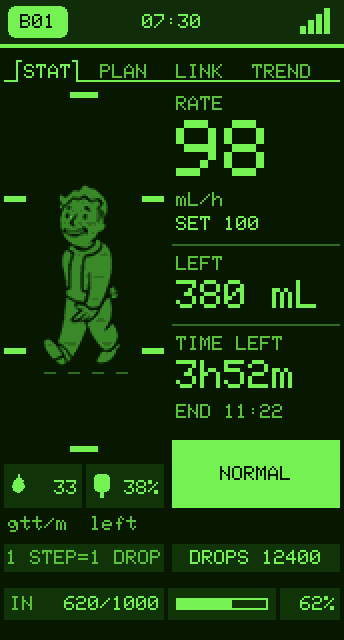
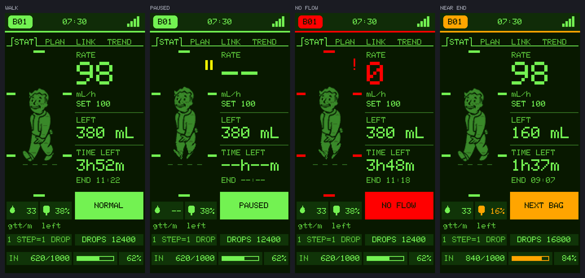

# เครื่องประจำเตียง รุ่นพิเศษ Fallout v1.1.0-FO

รุ่นหน้าตาพิเศษของเครื่องประจำเตียงสายหลัก (ESP32-S3 + จอ TFT สี 172x320)
จอทั้งเครื่องใช้จานสีของจอ Pip-Boy หน้า 1 จัดแบบหน้า STAT ของ Pip-Boy
และ **เปลี่ยนภาพถุงน้ำเกลือเป็น Vault Boy ที่ก้าวหนึ่งก้าวต่อหนึ่งหยดที่ตรวจจับได้จริง**

ต้นแบบคือภาพ `statpip0.bmp` ของโครงการ
[PipBoy_2040 ของ Adafruit](https://github.com/adafruit/Adafruit_Learning_System_Guides/tree/main/PipBoy_2040)
ทั้งภาพตัวละครและจานสีมาจากไฟล์นั้น (ที่มาและสัญญาอนุญาตอยู่ที่ `tools/fallout-sprite/SOURCE.md`)



ภาพเคลื่อนไหวข้างบนสร้างจากโค้ดตัวจริง หยดทุกหยดผ่าน `onDropDetected()` แล้วให้
`updateDripAnimation()` วาด ช่วงแรกหยดตามอัตรา 98 mL/h (ราว 1.8 วินาทีต่อหยด)
แล้วถี่ขึ้น ให้เห็นว่าหยดถี่ ตัวละครก็เดินเร็วขึ้นตาม ตัวนับ DROPS เพิ่มทีละหนึ่งพร้อมกับก้าว

## หน้า 1 อ่านอย่างไร

| ภาพ | ความหมาย |
|---|---|
| ก้าวหนึ่งก้าว แล้วยืนนิ่ง | มีหยดตกหนึ่งหยด พยาบาลเทียบกับกระเปาะหยดจริงได้ด้วยตา |
| เดินต่อเนื่อง | หยดถี่ |
| ยืนนิ่งนาน | หยดห่าง หรือหยุดไหล (ดูการ์ดสถานะประกอบ) |
| ยืนขาชิดพร้อม `\|\|` สีเหลือง | หยุดให้ชั่วคราว (PAUSED) |
| ยืนขาชิด ขีดกรอบเป็นสีแดง พร้อม `!` สีแดง | ไม่มีการไหล (NO FLOW) ทั้งที่เครื่องนี้ตรวจเองและที่ Host แจ้ง |
| กล่องไอคอนหยด | อัตราหยดต่อนาที |
| กล่องไอคอนถุง | ปริมาตรที่เหลือในถุงเป็น % แทนระดับน้ำในภาพถุงเดิม เป็นสีส้มเมื่อใกล้หมด |
| ปุ่ม DROPS | จำนวนหยดสะสม เพิ่มพร้อมกับทุกก้าว |
| แถบล่างแบบ HP / LEVEL / AP | ปริมาตรที่ให้ไปแล้ว / แถบความคืบหน้า / เปอร์เซ็นต์ |



ตัวเลขทุกค่าทางขวา (อัตราไหล ปริมาตรเหลือ เวลาเหลือ การ์ดสถานะ) และหน้า 2 ถึง 4
หน้าเตือน หน้าตั้งเลขเตียง เหมือนสายหลักทุกอย่าง ต่างกันแค่สี

## ภาพ Vault Boy สามเฟรมมาจากภาพเดียว

ภาพต้นทางมี Vault Boy ท่าเดินแค่ท่าเดียว (ก้าวยาว) `tools/fallout-sprite/make_sprite.py`
ตัดตัวละครออกมาขนาด 49x96 พิกเซล แล้วสร้างอีกสองเฟรมด้วยการหุบขาเข้าหากันตั้งแต่สะโพก
ลงไปถึงเท้า พร้อมยกตัวขึ้นทีละพิกเซล หนึ่งหยดเล่นเฟรม 0 1 2 1 0 หนึ่งรอบใน 340 ms
ระหว่างรอหยดถัดไปยืนในท่าก้าวยาว ซึ่งเป็นภาพต้นฉบับพอดี

เก็บพิกเซลละ 4 บิตใน `pipboy_sprite.h` ทั้งสามเฟรมใช้แฟลชราว 7 KB
สีพื้นของภาพเท่ากับสีพื้นจอ จึงวาดทับเฟรมเดิมได้เลยโดยไม่ต้องล้างก่อน จอไม่กะพริบ
และวาดใหม่เฉพาะตอนเปลี่ยนเฟรม (สี่ครั้งต่อหนึ่งก้าว) ไม่ได้วาดทุกรอบลูป

แก้ภาพต้นทางหรือท่าทางแล้วสร้างไฟล์ใหม่ด้วย `python3 tools/fallout-sprite/make_sprite.py`
ชุดตรวจจะไม่ผ่านถ้า `pipboy_sprite.h` ไม่ตรงกับที่สคริปต์สร้าง

## เครื่องหมายการค้า

Vault Boy, Pip-Boy และ Fallout เป็นเครื่องหมายการค้าของ Bethesda Softworks
สัญญาอนุญาต MIT ของ Adafruit ไม่ได้ให้สิทธิ์ในตัวละคร โครงการนี้ใช้เพื่อการศึกษาโดยไม่แสวงหากำไร
**ถ้าจะนำเครื่องไปใช้เชิงพาณิชย์ ให้ใช้สายหลัก หรือเปลี่ยนภาพตัวละครก่อน**

## สีเตือนไม่ได้ถูกธีมกลืน

สีแดง (วิกฤต) ส้ม (ใกล้หมด) และเหลือง (หยุดชั่วคราว) คงค่าเดิมของสายหลัก
เพราะพยาบาลแยกความเร่งด่วนด้วยสี ธีมเขียวทั้งจอจึงยิ่งทำให้สีเตือนเด่นขึ้น

## ตรรกะเหมือนสายหลักทุกบรรทัด

Arduino IDE ไม่ยอมให้สเก็ตช์ `#include` ไฟล์จากโฟลเดอร์อื่น `Station-Fallout.ino`
จึงเป็นสำเนาของ `firmware/Station/Station.ino` ที่ต่างได้แค่สามอย่าง

1. หัวไฟล์ Doxygen
2. บรรทัด `#define APP_VERSION`
3. ค่าสีใน `#define THEME_*` `COLOR_*` `UI_*`

และ `drop_detector.h` ต้องเหมือนของสายหลักทุกไบต์ ตรวจทั้งหมด (รวมถึงภาพตัวละคร) ด้วย

```bash
bash tools/fallout-sync/run.sh
```

**แก้สายหลักเมื่อไร ต้องสร้างสำเนาใหม่ด้วย** `python3 tools/fallout-sync/sync.py --write`
การแก้บั๊กด้านความปลอดภัยของสายหลักจึงไหลมาถึงรุ่นนี้เสมอ ไฟล์ที่เป็นของรุ่นนี้เองมีแค่
`StationScreen.h` และ `pipboy_sprite.h` (สร้างอัตโนมัติ)

## ใช้คู่กับอะไร

ใช้แทน `firmware/Station/` ได้ทันที โครงสร้างแพ็กเก็ต Protocol v3 และผังขาเหมือนกันทุกอย่าง
Host ทุกรุ่นเห็นเป็นเครื่องประจำเตียงปกติ ไม่ต้องแก้ฝั่ง Host

## ภาพจำลอง

```bash
bash tools/station-preview/run.sh ../../docs/screens-fallout ../../firmware/Station-Fallout/Station-Fallout.ino
```

ได้ภาพทุกหน้าใน `docs/screens-fallout/` พร้อม `p1_walk.gif`

## ข้อจำกัด

เฟิร์มแวร์นี้ **ยังไม่ได้ทดสอบบนฮาร์ดแวร์จริง** ตรวจด้วยเครื่องมือจำลองบน PC เท่านั้น
สิ่งที่ควรดูบนเครื่องจริง: ภาพเคลื่อนไหววาดราว 30 เฟรมต่อวินาทีเฉพาะช่วงที่ก้าว
(340 ms ต่อก้าว) ถ้าจอกระพริบหรือการนับหยดพลาดระหว่างก้าว ให้ลด `FO_STEP_MS`
หรือเพิ่มช่วงห่างของเฟรมใน `updateDripAnimation()`
