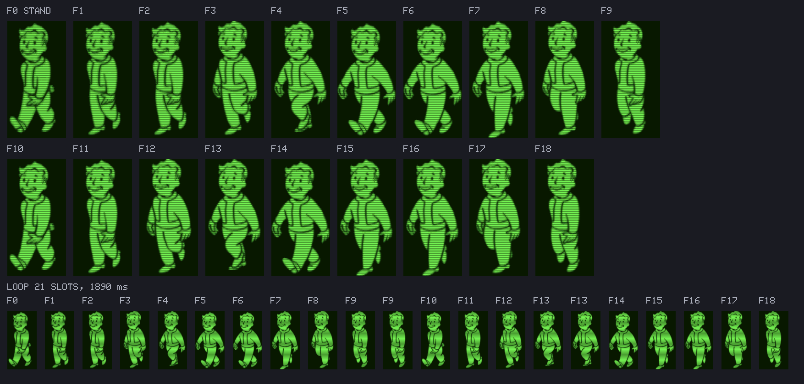
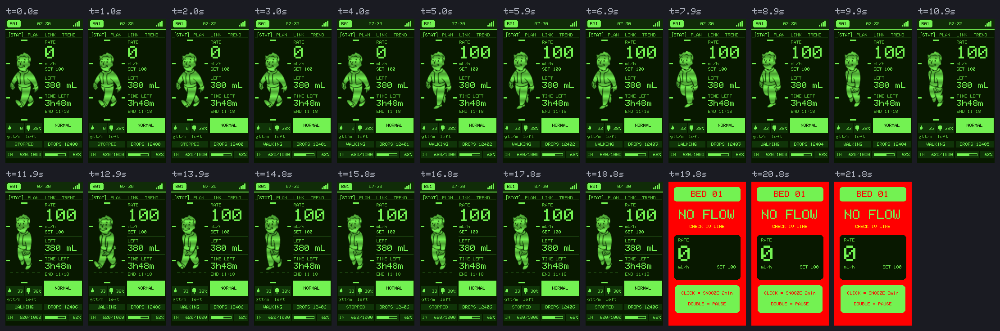

# เครื่องประจำเตียง รุ่นพิเศษ Fallout v1.4.0-FO

รุ่นหน้าตาพิเศษของเครื่องประจำเตียงสายหลัก (ESP32-S3 + จอ TFT สี 172x320)
จอทั้งเครื่องใช้จานสีของจอ Pip-Boy หน้า 1 จัดแบบหน้า STAT ของ Pip-Boy
และ **เปลี่ยนภาพถุงน้ำเกลือเป็น Vault Boy ที่เดินเมื่อน้ำเกลือกำลังหยด และหยุดเมื่อหยดหยุด**

ต้นแบบของหน้าจอและจานสีคือภาพ `statpip0.bmp` ของโครงการ
[PipBoy_2040 ของ Adafruit](https://github.com/adafruit/Adafruit_Learning_System_Guides/tree/main/PipBoy_2040)
ภาพตัวละครคือเฟรมภาพเคลื่อนไหวต้นฉบับ 21 เฟรม (`tools/fallout-sprite/walk/`) เส้นสแกนแบบจอ CRT
ที่มาของไฟล์อยู่ที่ `tools/fallout-sprite/SOURCE.md`


ภาพเคลื่อนไหวข้างบนสร้างจากโค้ดตัวจริง หยดทุกหยดผ่าน `onDropDetected()` แล้วให้
`updateDripAnimation()` วาด หยดตามอัตรา 98 mL/h (ราว 1.8 วินาทีต่อหยด) หกหยดแล้วหยุด
Vault Boy เดินต่อเนื่องระหว่างหยด แล้วหยุดค้างท่าเองราว 4.6 วินาทีหลังหยดสุดท้าย

## ภาพเดินแยกจากจังหวะหยด

ตั้งแต่ 1.3.0-FO ภาพเดิน **ไม่ได้ก้าวตามหยดแต่ละหยดแล้ว** แยกเป็นสองส่วนชัดเจน

| ส่วน | หน้าที่ | ตัดสินจาก |
|---|---|---|
| 1. กำลังหยดอยู่ไหม (`foDripping`) | บอกแค่ "เดิน" หรือ "หยุด" | เวลาของหยดล่าสุดเท่านั้น |
| 2. ภาพเดิน (`updateDripAnimation`) | เล่นวนตามลำดับและเวลาของเฟรมใน `pipboy_sprite.h` | นาฬิกาของตัวเอง |

* **เริ่มหยด** ภาพเริ่มเดินต่อจากท่าที่ค้างไว้ ความเร็วเท่าเดิมเสมอ หยดถี่หรือห่างก็ไม่เปลี่ยน
* **หยดหยุด** ภาพหยุดค้างท่าปัจจุบัน เมื่อไม่มีหยดใหม่นานเกิน 2.5 เท่าของช่วงห่างระหว่างหยด
  ขณะนั้น (อย่างน้อย 3 วินาที แต่ไม่เกินเกณฑ์ NO FLOW) ภาพจึงหยุดก่อนหรือพร้อมกับที่การ์ดขึ้น NO FLOW
* ปุ่มซ้ายใต้ภาพบอกผลของส่วนที่ 1 ตรง ๆ ว่า `WALKING` หรือ `STOPPED`

## ภาพจำลองการแสดงผลทั้งหมดของภาพเดิน

อยู่ใน `docs/screens-fallout/anim/` สร้างใหม่ทุกครั้งที่รัน `tools/station-preview/run.sh` กับสาย Fallout
ทุกฉากเรียก `loop()` ตัวจริงทุก 30 ms การตัดสินสัญญาณเตือน หน้าเตือนเต็มจอ ปุ่ม และการวาด
เป็นของเฟิร์มแวร์ทั้งหมด ตัวขับใส่ให้แค่หยด (`onDropDetected()`) การกดหยุดชั่วคราว
(`togglePause()` ตัวเดียวกับปุ่ม) และ Sync จาก Host แต่ละฉากมีทั้ง GIF และแผ่นเรียงภาพทุกหนึ่งวินาที

| ไฟล์ | แสดงอะไร |
|---|---|
| `frames.png` | ทุกเฟรมที่เก็บในเฟิร์มแวร์ ถอดจาก `pipboy_sprite.h` โดยตรง พร้อมลำดับการเล่นวนหนึ่งรอบ |
| `s1_start_stop` | STOPPED → หยดแรก WALKING → หยดหยุด ภาพค้าง STOPPED → ครบเกณฑ์ NO FLOW เฟิร์มแวร์เปิดหน้าเตือนเต็มจอ |
| `s2_pause_resume` | เดิน → กดหยุด ยืนพร้อม `\|\|` → กดกลับ ยังไม่เดินจนกว่าหยดแรกหลังกลับมาจะถึง → เดินต่อ |
| `s3_slow_fast` | หยดห่าง 3 วินาที แล้วถี่ 0.6 วินาที ภาพเดินเร็วเท่าเดิมตลอด (แยกจากจังหวะหยดจริง) |
| `s4_near_end` | Host ส่งรหัส NEAR END ที่รับทราบแล้ว เดินในหน้า 1 ที่เป็นสีส้ม |




## หน้า 1 อ่านอย่างไร

| ภาพ | ความหมาย |
|---|---|
| Vault Boy เดิน / ปุ่ม `WALKING` | น้ำเกลือกำลังหยด |
| Vault Boy หยุดค้างท่า / ปุ่ม `STOPPED` | ไม่มีหยดมาสักพัก (ดูการ์ดสถานะประกอบ) |
| ยืนพร้อม `\|\|` สีเหลือง | หยุดให้ชั่วคราว (PAUSED) |
| ยืน ขีดกรอบเป็นสีแดง พร้อม `!` สีแดง | ไม่มีการไหล (NO FLOW) ทั้งที่เครื่องนี้ตรวจเองและที่ Host แจ้ง |
| กล่องไอคอนหยด | อัตราหยดต่อนาที |
| กล่องไอคอนถุง | ปริมาตรที่เหลือในถุงเป็น % แทนระดับน้ำในภาพถุงเดิม เป็นสีส้มเมื่อใกล้หมด |
| ปุ่ม DROPS | จำนวนหยดสะสม |
| แถบล่างแบบ HP / LEVEL / AP | ปริมาตรที่ให้ไปแล้ว / แถบความคืบหน้า / เปอร์เซ็นต์ |


ตัวเลขทุกค่าทางขวา (อัตราไหล ปริมาตรเหลือ เวลาเหลือ การ์ดสถานะ) และหน้า 2 ถึง 4
หน้าเตือน หน้าตั้งเลขเตียง เหมือนสายหลักทุกอย่าง ต่างกันแค่สี

## เฟรมภาพเดิน 21 เฟรม

ตั้งแต่ 1.4.0-FO ใช้เฟรมภาพเคลื่อนไหวต้นฉบับครบทุกเฟรม จาก `tools/fallout-sprite/walk/01.jpg`
ถึง `21.jpg` เล่นตามลำดับชื่อไฟล์ เฟรมละ 90 ms (11 เฟรมต่อหนึ่งรอบก้าว ราว 1 วินาที
ใกล้จังหวะเดินจริง) ครบ 21 เฟรมใน 1.89 วินาที แล้ววนใหม่


* ทุกเฟรมผ่านขั้นเดียวกัน ลบเส้นสแกนเดิม ตัดเฉพาะตัวละคร (กรอบรวมของทุกเฟรม ตัวละครจึงไม่กระโดด)
  ย่อเหลือ 64x128 แปลงเป็นจานสี 16 ระดับ แล้วใส่เส้นสแกนใหม่แถวเว้นแถว
* ไฟล์ที่ได้ผลเหมือนกันทุกพิกเซลหลังแปลงเก็บครั้งเดียว (10 กับ 11, 15 กับ 16)
  เก็บจริง 19 เฟรม ใช้แฟลชราว 78 KB ลำดับการเล่นยังครบทั้ง 21 ช่อง
* หยุดชั่วคราวและไม่ไหลใช้ท่าของ `01.jpg` (ท่าเดียวกับภาพนิ่งอ้างอิงเดิม) เพราะทุกเฟรม
  เป็นท่ากำลังเดิน ไม่มีท่ายืนนิ่ง เปลี่ยนได้ที่ `WALK_STAND_FILE` ใน `make_sprite.py`
* ปรับความเร็วได้ที่ `WALK_MS` ใน `make_sprite.py` แล้วรันใหม่

```bash
python3 tools/fallout-sprite/make_sprite.py
bash tools/station-preview/run.sh ../../docs/screens-fallout ../../firmware/Station-Fallout/Station-Fallout.ino
```

`make_sprite.py` เลือกต้นทางตามลำดับนี้ ใช้แบบแรกที่มีไฟล์

1. โฟลเดอร์ `walk/` เฟรมทีละไฟล์ (ใช้อยู่ตอนนี้)
2. `vaultboy_walk.gif` ทุกเฟรมตามลำดับและเวลาในไฟล์
3. `vaultboy_walk.webp` ภาพนิ่งท่าเดียว สร้างท่าเดินห้าเฟรมเอง (วิธีที่ใช้ใน 1.2.0-FO ถึง 1.3.1-FO:
   เฉือนหน้าแข้งตามความลึกจากสะโพก เลื่อนรองเท้าทั้งชิ้น ยกเท้าหลังตอนขาสวนกัน)

ชุดตรวจจะไม่ผ่านถ้า `pipboy_sprite.h` ไม่ตรงกับที่สคริปต์สร้างจากต้นทาง

## เครื่องหมายการค้า

Vault Boy, Pip-Boy และ Fallout เป็นเครื่องหมายการค้าของ Bethesda Softworks
สัญญาอนุญาต MIT ของ Adafruit ไม่ได้ให้สิทธิ์ในตัวละคร โครงการนี้ใช้เพื่อการศึกษาโดยไม่แสวงหากำไร
**ถ้าจะนำเครื่องไปใช้เชิงพาณิชย์ ให้ใช้สายหลัก หรือเปลี่ยนภาพตัวละครก่อน**

## สีเตือนไม่ได้ถูกธีมกลืน

สีแดง (วิกฤต) ส้ม (ใกล้หมด) และเหลือง (หยุดชั่วคราว) คงค่าเดิมของสายหลัก
เพราะพยาบาลแยกความเร่งด่วนด้วยสี ธีมเขียวทั้งจอจึงยิ่งทำให้สีเตือนเด่นขึ้น

## ตรรกะเหมือนสายหลักทุกบรรทัด

Arduino IDE ไม่ยอมให้สเก็ตช์ `#include` ไฟล์จากโฟลเดอร์อื่น `Station-Fallout.ino`
จึงเป็นสำเนาของ `firmware/Station/Station.ino` ที่ต่างได้แค่สามอย่าง

1. หัวไฟล์ Doxygen
2. บรรทัด `#define APP_VERSION`
3. ค่าสีใน `#define THEME_*` `COLOR_*` `UI_*`

และ `drop_detector.h` ต้องเหมือนของสายหลักทุกไบต์ ตรวจทั้งหมด (รวมถึงภาพตัวละคร) ด้วย

```bash
bash tools/fallout-sync/run.sh
```

**แก้สายหลักเมื่อไร ต้องสร้างสำเนาใหม่ด้วย** `python3 tools/fallout-sync/sync.py --write`
การแก้บั๊กด้านความปลอดภัยของสายหลักจึงไหลมาถึงรุ่นนี้เสมอ ไฟล์ที่เป็นของรุ่นนี้เองมีแค่
`StationScreen.h` และ `pipboy_sprite.h` (สร้างอัตโนมัติ)

## ใช้คู่กับอะไร

ใช้แทน `firmware/Station/` ได้ทันที โครงสร้างแพ็กเก็ต Protocol v3 และผังขาเหมือนกันทุกอย่าง
Host ทุกรุ่นเห็นเป็นเครื่องประจำเตียงปกติ ไม่ต้องแก้ฝั่ง Host

## ภาพจำลอง

```bash
bash tools/station-preview/run.sh ../../docs/screens-fallout ../../firmware/Station-Fallout/Station-Fallout.ino
```

ได้ภาพทุกหน้าใน `docs/screens-fallout/` พร้อม `p1_walk.gif`

## ข้อจำกัด

เฟิร์มแวร์นี้ **ยังไม่ได้ทดสอบบนฮาร์ดแวร์จริง** ตรวจด้วยเครื่องมือจำลองบน PC เท่านั้น
สิ่งที่ควรดูบนเครื่องจริง: ภาพเคลื่อนไหววาดราว 30 เฟรมต่อวินาทีเฉพาะช่วงที่ก้าว
(340 ms ต่อก้าว) ถ้าจอกระพริบหรือการนับหยดพลาดระหว่างก้าว ให้ลด `FO_STEP_MS`
หรือเพิ่มช่วงห่างของเฟรมใน `updateDripAnimation()`
